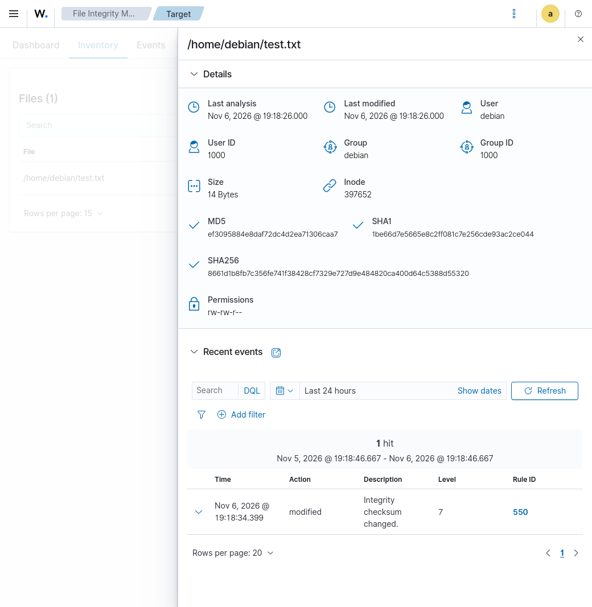

# Endpoint Security 
## File Integrity Monitor  
### Configure 
Configure the File Integrity Monitoring on the agent.  
Create a sample file on agent to be monitored for changes.  
```
cd ~/
touch test.txt
``` 
Open the configuration file on this agent.
```
sudo nano /var/ossec/etc/ossec.conf
```
Add a direcories check under the syscheck section to monitor the test file created earlier.
```
 <!-- File integrity monitoring -->
  <syscheck>
    <disabled>no</disabled>

    <!-- Frequency that syscheck is executed default every 12 hours -->
    <frequency>43200</frequency>

    <scan_on_start>yes</scan_on_start>

    <!-- Directories to check  (perform all possible verifications) -->
    <!-- <directories>/etc,/usr/bin,/usr/sbin</directories> -->
    <!-- <directories>/bin,/sbin,/boot</directories> -->
    <directories check_all="yes" realtime="yes">/home/debian/test.txt</directories>
```
Restart the agent service to let the changes take effect.
```
sudo systemctl restart wazuh-agent
```

Update a line in this monitored file.
```
echo 'Line 1' >> test.txt
```
Visit the Manager and check for FIM changes.
   

Use the md5sum check to verify the checksum from the manager in the screenshot matches test.txt on the agent.  
```
md5sum test.txt 
ef3095884e8daf72dc4d2ea71306caa7  test.txt
```

Endpoint Security > Malware Detection
On the Agent Debian 13 VM, download the EICAR test file.
