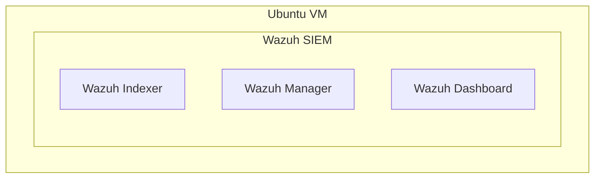
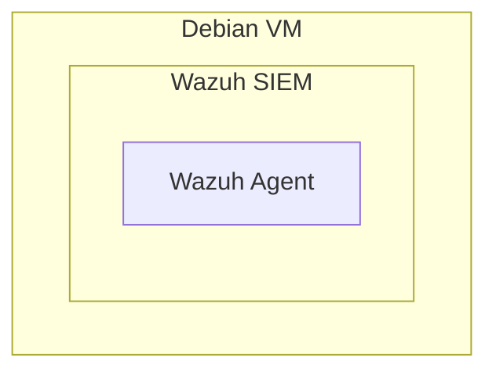

# Wazuh Indexer, Manager, and Dashboard  
  
## Environment  
- VirtualBox 7.2 - Hosts Ubuntu 24
- Ubuntu 24 - For Wazuh indexer, Wazuh manager, and Wazuh dashboard.


### Installation  
Download the installation assistant script.
```
curl https://packages.wazuh.com/4.14/wazuh-install.sh
```
Run the installation assistant script all-in-one for the indexer, manager, and dashboard using the -a flag.  
```
sudo bash ./wazuh-install.sh -a
```
As the install finsihes, an admin password will be displayed. Save this admin password because it is needed to log into the dashboard later. 
```
sudo tar -O -xvf wazuh-install-files.tar wazuh-install-files/wazuh-passwords.txt > wazuh-passwords.txt
```
Following the installations, check that the services are active.
```
sudo systemctl is-active wazuh-indexer wazuh-manager wazuh-dashboard 
```
Expect each service to return, active.  
In a web browser visit the local dashboard instance 127.0.0.1. Login using admin and the password given to you at the end of the install script.

# Wazuh Agent
## Environment  
- VirtualBox 7.2 - Hosts Debian 13
- Debian 13 - For Wazuh Agent

### Installation 
Follow the Wazuh documentation page for individual architectures and dependency needs.  
https://documentation.wazuh.com/current/installation-guide/wazuh-agent/wazuh-agent-package-linux.html
https://documentation.wazuh.com/current/installation-guide/packages-list.html  
Download the public GPG key.  
```
curl -s https://packages.wazuh.com/key/GPG-KEY-WAZUH | sudo gpg --no-default-keyring --keyring gnupg-ring:/usr/share/keyrings/wazuh.gpg --import
```
Modify the permissions so that APT can read the key.
```
sudo chmod 644 /usr/share/keyrings/wazuh.gpg
```
Add the repository to the APT package manager.
```
echo "deb [signed-by=/usr/share/keyrings/wazuh.gpg] https://packages.wazuh.com/4.x/apt/ stable main" | tee -a /etc/apt/sources.list.d/wazuh.list
```
Open a text editor and modify the Wazuh agent configuration file which holds settings for this local agent.
```
sudo nano /var/ossec/etc/ossec.conf
```
Find and update the Wazuh manager IP address.
```
<ossec_config>
  <client>
    <server>
      <address>192.168.1.213</address>
      <port>1514</port>
      <protocol>tcp</protocol>
    </server>
```
Restart the agent to make changes happen.
```
sudo systemctl restart wazuh-agent
```
Check the status of the agent.
```
sudo systemctl status wazuh-agent
● wazuh-agent.service - Wazuh agent
     Loaded: loaded (/usr/lib/systemd/system/wazuh-agent.service; enabled; preset: enable>
     Active: active (running) since Fri 2026-11-06 16:39:20 EST; 7s ago
```
